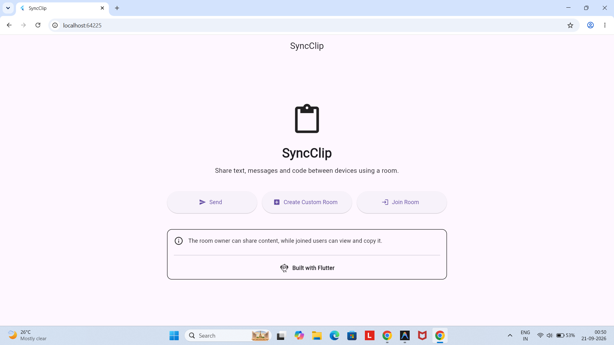
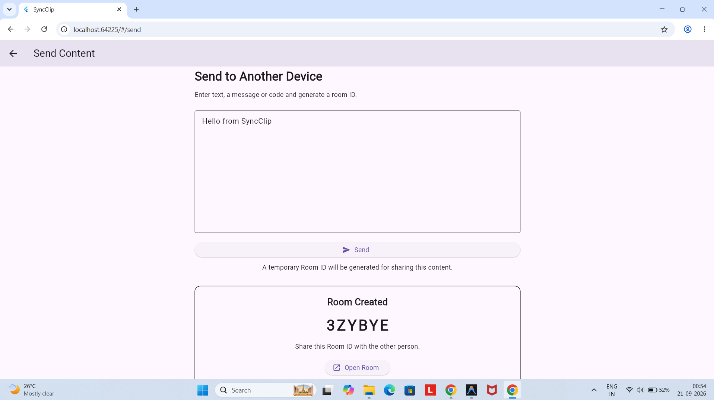
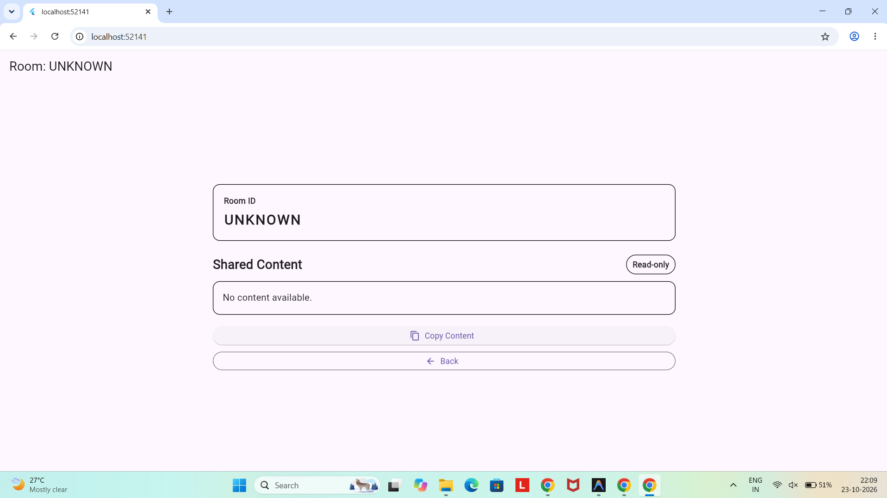
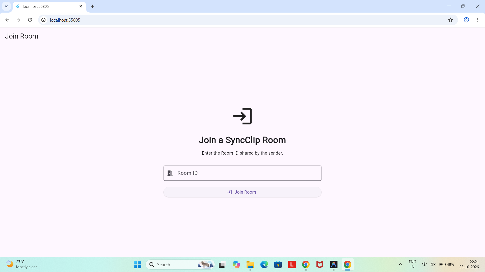
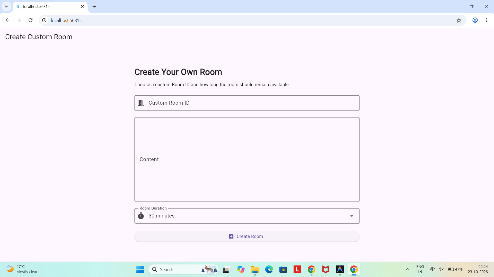

# SyncClip

SyncClip is a Flutter-based clipboard sharing prototype designed to demonstrate sharing text, messages, and code between users through temporary rooms.

## About My Project

SyncClip is a Flutter application prototype for sharing text, messages, and code through rooms. I explored how users can enter content, generate or choose a Room ID, and move between different screens to view and copy content.

This project helped me understand how a Flutter application is organised and how its screens are connected.

## Features

Home Screen: Provides options to send content, join a room, or create a custom room.
Send Screen: Accepts text or code and generates a Room ID.
Custom Room: Allows users to enter their own Room ID and select a duration.
Join Room: Allows users to enter a Room ID and open the room screen.
Room Screen: Displays available content and provides a copy-to-clipboard option.
Responsive Layout: The home screen adjusts its button arrangement for different screen widths.
Screen Navigation: Connects the app screens using named routes.

## Flutter Widgets and Concepts Observed in My Project

### StatelessWidget

In my project, `SyncClipApp` in `lib/main.dart` uses StatelessWidget. I observed that it sets up the MaterialApp and defines the routes used to navigate between the different screens.

Code used in my project:

```dart
class SyncClipApp extends StatelessWidget {
  const SyncClipApp({super.key});

  @override
  Widget build(BuildContext context) {
    return MaterialApp(
```

Output Screenshot:

The home screen of SyncClip shows the output of the application setup, with options to Send, Join Room, and Create Custom Room.



### StatefulWidget

In my project, `SendScreen` in `lib/screens/send_screen.dart` uses `StatefulWidget`. I observed that it allows the screen to update when the user interacts with it, such as generating a Room ID.

Code used in my project:

```dart
class SendScreen extends StatefulWidget {
  const SendScreen({super.key});

  @override
  State<SendScreen> createState() => _SendScreenState();
}
```

Output Screenshot:

The Send screen allows the user to enter content and generate a Room ID.




### setState()

In my project, I used `setState()` in `send_screen.dart` to update the screen after generating a Room ID. When the user enters content and sends it, the generated Room ID is stored in the `roomId` variable.

Code used in my project:

```dart
setState(() {
  roomId = generateRoomId();
});
```

Output Screenshot:

The Send screen displays the generated Room ID after the user enters content and proceeds.


### TextEditingController

In my project, I used `TextEditingController` in `send_screen.dart` to access the text entered by the user before generating a Room ID.

Code used in my project:

```dart
final TextEditingController contentController =
    TextEditingController();
```

Output Screenshot:

The Send screen contains a text field where the user can enter content to share.


### Navigator and Named Routes

In my project, I used named routes in `main.dart` to connect the five screens. The `Navigator.pushNamed()` method allows users to move to another screen when they select an option.

Code used in my project:

```dart
initialRoute: '/',

routes: {
  '/': (context) => const HomeScreen(),
  '/send': (context) => const SendScreen(),
  '/custom-room': (context) => const CustomRoomScreen(),
  '/join': (context) => const JoinRoomScreen(),
  '/room': (context) => const RoomScreen(),
},
```

Output Screenshot:

The home screen provides options to navigate to the Send, Join Room, and Create Custom Room screens.





### MediaQuery and Responsive Layout

In my project, I used `MediaQuery` in `home_screen.dart` to check the screen width. The layout displays buttons in a column on mobile-sized screens and in a row on wider screens.

Code used in my project:

```dart
final screenWidth = MediaQuery.of(context).size.width;
final isMobile = screenWidth < 600;
```

Output Screenshot:

The home screen adjusts its button layout based on the available screen width.


### ElevatedButton.icon

In my project, I used `ElevatedButton.icon` in `home_screen.dart` to create buttons with icons and labels. These buttons allow users to navigate to different screens.

Code used in my project:

```dart
ElevatedButton.icon(
  onPressed: () {
    Navigator.pushNamed(context, route);
  },
  icon: Icon(icon),
  label: Text(title),
)
```

Output Screenshot:

The home screen displays buttons for Send, Create Custom Room, and Join Room.


### Clipboard.setData()

In my project, I used `Clipboard.setData()` in `room_screen.dart` to copy the displayed content to the clipboard when the user presses the Copy Content button.

Code used in my project:

```dart
await Clipboard.setData(
  ClipboardData(text: content.toString()),
);
```

Output Screenshot:

The Room screen provides a Copy Content button to copy the shared text.


### SelectableText()

In my project, I used `SelectableText()` in `room_screen.dart` to display the shared content and allow users to select and copy text directly from the screen.

Code used in my project:

```dart
SelectableText(
  content.toString(),
  style: const TextStyle(fontSize: 16, height: 1.5),
),
```

Output Screenshot:


### SingleChildScrollView()

In my project, I used `SingleChildScrollView()` in `room_screen.dart` to allow users to scroll through the room content when it does not fit on the screen.

Code used in my project:

```dart
SingleChildScrollView(
  padding: const EdgeInsets.all(24),
  child: ConstrainedBox(
    constraints: const BoxConstraints(maxWidth: 800),
    child: Column(
      // Room screen content
    ),
  ),
),
```

Output Screenshot:


## Screenshots

### Home Screen


### Send Screen


### Join Room Screen


### Custom Room Screen


### Room Screen


## Project Structure

```text
lib/
├── main.dart
└── screens/
    ├── home_screen.dart
    ├── send_screen.dart
    ├── custom_room_screen.dart
    ├── join_room_screen.dart
    └── room_screen.dart
```
